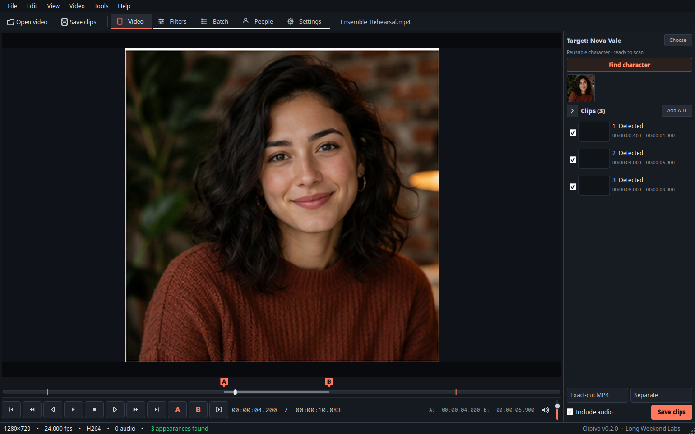
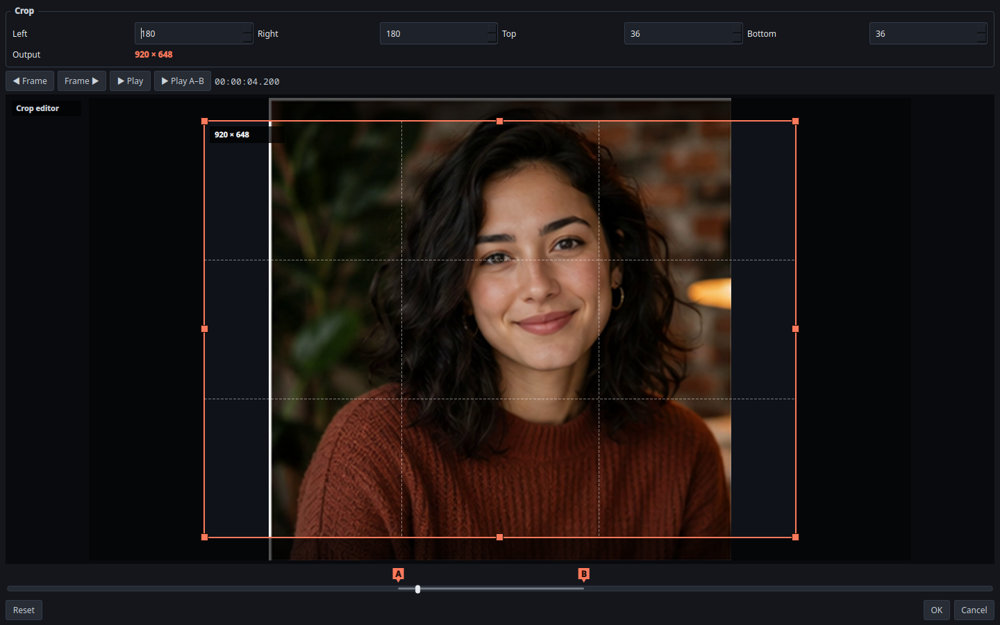

# Clipivo

**Cut every clip of one person out of your videos, automatically.**

Clipivo is a local-first desktop video cutter. Teach it a face, point it at a folder of videos, and it finds every appearance of that person and exports each one as its own clip, or all of them stitched into a compilation. It also works as a plain, precise manual cutter when that is all you need. Everything runs on your own machine.

## Teach it a face once, use it everywhere

Create a character and give it face photos: add them individually, import a folder, or capture the current video frame. Five to fifteen varied references work best.

Clipivo rejects images it cannot read or that contain no face, warns you about images with several faces or an inconsistent outlier, and offers a still-photo match test so you can check a reference set before committing it to a video analysis.

Characters are either reusable across every video you import, or attached to one video only when you do not want them cluttering the library. Batch import takes a folder whose immediate subfolders are character names, validates every image inside recursively, and merges into an existing character rather than replacing it.

Reference metadata and images live in an AES-256-GCM store whose key is held by the Linux keyring.

## Find them, then find the next one

`Find character` searches the whole video and jumps to the first confident match. It starts with a fast sparse pass over keyframes at 320px, retries keyframes with the high-resolution detector when that misses, and only then falls back to a careful sequential sweep, refining every hit against normal frames. A not-found result is reported only after all three passes have covered the entire video.

Results are cached against the video, the reference set and the strictness setting, so running it again or reopening the file jumps straight there. After the first hit the button becomes `Find next`, which samples forward until the person has been absent for a confirmed gap, then finds their next entrance. Each distinct appearance is marked on the timeline.

## Batch: many videos, many people, unattended

Add videos individually or pull in everything under a folder, tick the characters you want, and choose separate appearance clips or one compilation per source and character.

Each source is decoded once per analysis pass and compared against every selected character. You can tick `Review` on any row to have Clipivo open the generated ranges in the editor and wait for your approval before exporting. The queue starts, pauses and cancels safely, its state survives a restart, and scrubbing in the foreground pauses face analysis so the editor stays responsive.

The coarse scan is followed by 200 ms local boundary scans, so clips start and end on matching frames without invisible padding, and overlapping ranges are merged instead of exporting the same footage twice. Outputs are named `source_YYMMDD_HHMM_SSS[_NNN]_Character.mp4`.

## It refuses to lose your footage

Automatic exports use H.264 and AAC with a bitrate ceiling derived from the source, so a compact AV1 file does not balloon several times in size just because H.264 was chosen. Pick CPU encoding with libx264 or hand it to an NVIDIA card with NVENC; the queue tells you which one it used.

Every result is checked before it is called a success: expected duration, plus a real decode of the frames at the end of the file. A failed result is deleted and its source kept. `Move source to Trash` is off by default, uses the Linux Trash rather than deleting, and runs only when every selected character produced a validated output. No-match, failed, cancelled, partial and unreviewed jobs always keep the source.

## An Avidemux-style filter chain

An ordered chain you build yourself: Crop, Rotate, Vertical flip and Frame rate under Transformation, Contrast and Color balance under Colors.

Crop gives you a shaded on-picture selection with draggable edges and corners, a movable frame, guides, and numeric margins that stay in sync. Contrast covers 50 to 150% contrast, -127 to 127 brightness, separate luma and chroma processing, an MPEG2-to-PC preset and a live histogram. Color Balance gives shadows, midtones and highlights their own hue, chroma, luma and saturation.

Preview the chain as input, filtered output, or the two compared, at any position. Every filter editor can play the filtered preview from where it sits or play only the A to B selection. Resample FPS keeps duration; Change speed creates synchronized slow and fast motion.

## Or just cut it by hand

Open an MP4, MKV, WebM, MOV, AVI or M4V. Playback runs through libVLC, so anything VLC can decode plays here without a separate codec hunt. Seek by timeline, frame, or keyframe. Press `A` at the start, `B` at the end, `Ctrl+Enter` to add the range, and enable or disable ranges in the right pane.

Exact-cut MP4 is the default and gives frame-accurate boundaries. Copy MP4 is there for when preserving the source stream without re-encoding matters more than an exact start on a non-keyframe.

## Status

Fedora Linux. No public release yet. Private build for personal use. Not for distribution.

## Feedback

[Open an issue](https://github.com/longweekendlabs/clipivo/issues) for a bug or a request.

## License

All rights reserved. See [LICENSE](LICENSE).

© 2026 Long Weekend Labs

---

Made with ♥ by **[Long Weekend Labs](https://github.com/longweekendlabs)**
